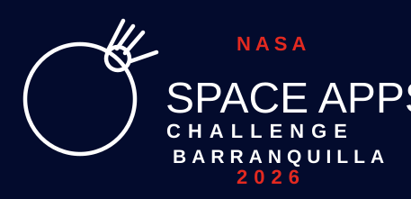

# Villa Anura

Videojuego educativo de exploración espacial en el que el jugador acompaña a Flyn en la preparación y ejecución de misiones. El proyecto utiliza una interfaz 2D de estilo pixel art y presenta conceptos básicos de planificación, experimentación y control de una nave espacial.

**Demo:** https://villa-anura.vercel.app/

## Características

- Interfaz disponible en español e inglés.
- Personaje guía llamado Flyn.
- Diseño y configuración de una nave espacial.
- Selección de sistemas de aerodinámica, combustible, oxígeno, seguridad, materiales y tecnología.
- Administración de presupuesto y masa de la nave.
- Experimento de botánica en microgravedad con variables de agua, radiación UV y dióxido de carbono.
- Simulación conceptual de descenso y aterrizaje controlado.
- Indicadores de velocidad, altitud y combustible.
- Música, efectos de sonido y control de audio.
- Registro local del progreso y las recompensas mediante el navegador.

## Misiones

### 1. Diseño y preparación de la nave

El jugador configura seis sistemas de la nave mediante un presupuesto inicial de 12.000 créditos. Cada alternativa muestra su costo y masa. La configuración debe respetar el límite de masa establecido para la misión.

### 2. Botánica en microgravedad

El jugador configura tres variables experimentales: agua, radiación ultravioleta y dióxido de carbono (CO₂). Después consulta los resultados disponibles para cada combinación contemplada en el experimento.

### 3. Regreso y aterrizaje controlado

El jugador administra el frenado y el combustible durante el descenso. Para completar el aterrizaje, debe llegar a la plataforma con una velocidad máxima de 18 km/h y conservar combustible.

## Tecnologías

- HTML5
- CSS3
- JavaScript (módulos ES)
- Canvas 2D
- Web Audio API
- LocalStorage

No se requiere un proceso de compilación ni la instalación de dependencias para ejecutar la versión actual.

## Estructura del proyecto

```text
Villa-Anura/
└── Villa_Anura_Canvas_JS/
    ├── index.html
    ├── css/
    │   └── style.css
    ├── js/
    │   ├── main.js
    │   ├── audio.js
    │   ├── config.js
    │   ├── input.js
    │   ├── player.js
    │   ├── scene.js
    │   ├── collectibles.js
    │   └── progress.js
    ├── assets/
    │   └── audio/
    └── docs/
        └── ROADMAP.md
```

## Ejecución local

1. Clona el repositorio:

   ```bash
   git clone https://github.com/Vall0215/Villa-Anura.git
   ```

2. Abre la carpeta de la aplicación:

   ```bash
   cd Villa-Anura/Villa_Anura_Canvas_JS
   ```

3. Inicia un servidor local. Por ejemplo, con Python:

   ```bash
   python -m http.server 8000
   ```

4. Abre en el navegador:

   ```text
   http://localhost:8000
   ```

También puedes abrir la carpeta de la aplicación en Visual Studio Code y utilizar la extensión Live Server.

## Recursos de audio

El módulo de audio utiliza los siguientes archivos dentro de `assets/audio/`:

- `ambient-sad.mp3`
- `landing-soft.mp3`
- `certificate-victory.mp3`
- `game-over.mp3`

Los archivos MP3 no están incluidos actualmente en el repositorio. Para disponer de la música y los efectos, agrega allí los recursos correspondientes.

